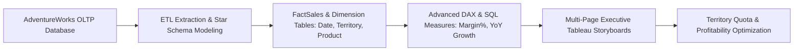

<div align="center">

  <!-- NATIVE ANIMATED CYBER BANNER -->
  

  <br/>

  <!-- ANIMATED TYPING SVG -->
  

  <br/>

  <!-- TECH BADGES -->
  <p align="center">
    
    
    
    
    
  </p>

</div>

---

### 🌟 System Overview

**Adventure Works Cycles BI Analytics** delivers comprehensive business intelligence across global multinational manufacturing and distribution operations. Spanning operations in North America, Europe, and Asia, it tracks end-to-end sales pipelines, regional gross margins, and manufacturing capacity utilization.

---

### 🔬 Operational Architecture & Data Pipeline Flow



---

### 🚀 Key Capabilities & Features

- **🚴 Multi-Regional Sales Insights:** Tracks regional distributor sales across continents with exchange rate normalization.
- **📈 YoY & MoM Growth Modeling:** Calculates compounded annual growth rates and territory quota achievements.
- **📦 Product Profitability Matrix:** Identifies high-margin bicycle components vs loss-leader accessories.
- **🌟 Star Schema Architecture:** High-performance dimensional design minimizing query execution latencies.

---

### ⚡ Quickstart & Execution

```bash
# 1. Clone & inspect
git clone https://github.com/Akshay-Notfound/Adventure-Works.git
cd Adventure-Works

# 2. Open dashboard files in Tableau / Power BI
```

---

### 👤 Author & Architecture

**Akshay Shivaji Rathod**  
*Data & AI Engineer*  
* 🌐 **Portfolio:** [akshay-notfound.vercel.app](https://akshay-notfound.vercel.app)  
* 💼 **LinkedIn:** [linkedin.com/in/akshay-rathod-aaab52206](https://www.linkedin.com/in/akshay-rathod-aaab52206/)  
* 🐙 **GitHub:** [@Akshay-Notfound](https://github.com/Akshay-Notfound)  

---

<div align="center">
  <sub>Licensed under the MIT License. Designed for scalability, intelligence, and performance.</sub>
</div>
